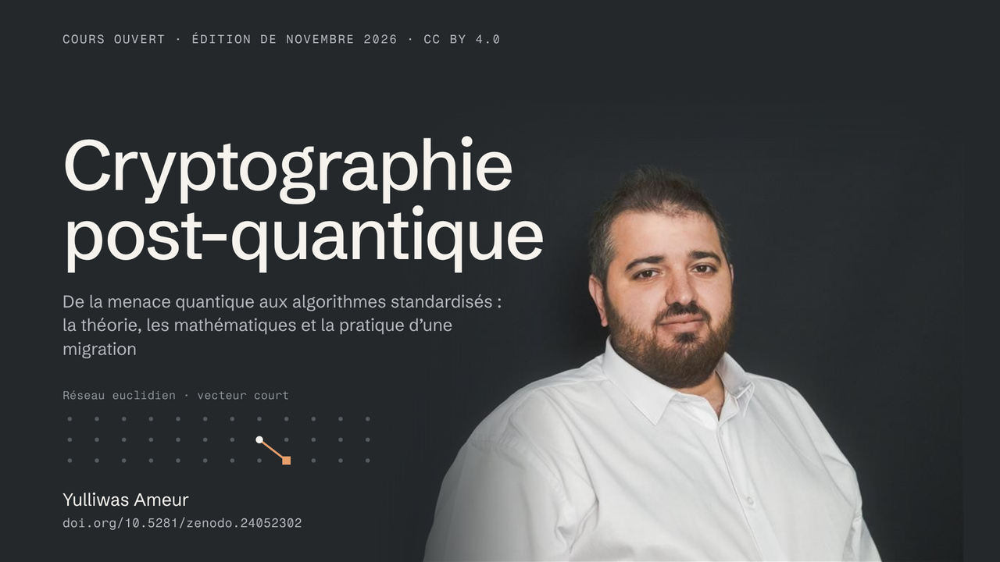

Cours ouvert en français sur la cryptographie post-quantique, de la menace quantique à la migration : algorithmes de Shor et de Grover, concepts fondamentaux, signatures à base de hachage (XMSS, LMS, SLH-DSA), cryptographie à base de codes correcteurs (McEliece, HQC), réseaux euclidiens (LWE, Module-LWE, ML-KEM, ML-DSA, FN-DSA), plan de transition (inventaire, mode hybride, agilité cryptographique, calendriers de l'ANSSI, du NIST et de l'Union européenne) et rappels mathématiques. 21 TP en Python et OpenSSL, tous exécutés : les sorties affichées sont réelles. Chaque notion est définie à trois niveaux : en une phrase, précisément, puis pour l'expert. Un fil rouge (une mutuelle santé fictive qui prépare sa migration) et un auto-test par module.

- **Télécharger / citer (DOI pérenne)** : [10.5281/zenodo.24052302](https://doi.org/10.5281/zenodo.24052302)
- **Licence** : [CC BY 4.0](https://creativecommons.org/licenses/by/4.0/deed.fr) — réutilisation et adaptation libres avec attribution, y compris en formation.

> Ameur, Y. (2026). *Cryptographie post-quantique — le cours (édition de novembre 2026)*. Zenodo. https://doi.org/10.5281/zenodo.24052302

Corrections et remarques sont les bienvenues : la prochaine édition en tiendra compte.
